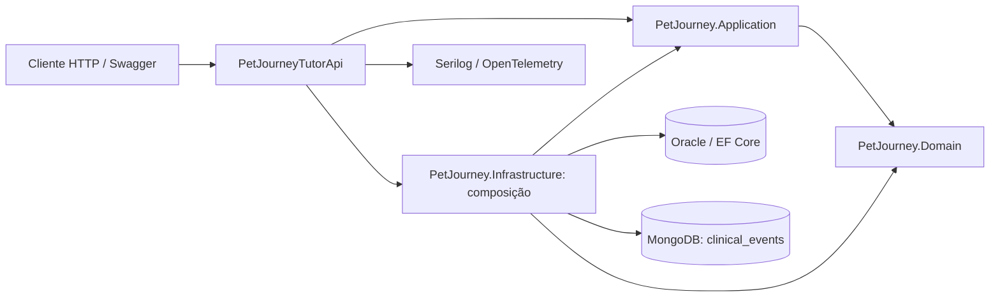

# Arquitetura da Sprint 4

Domain contém entidades e regras puras de cuidado. Os atributos de validação são da biblioteca padrão .NET; mapeamentos físicos estão na infraestrutura. Application recebe `IDataSession`, `IRepository<T>`, `IClinicalEventRepository`, `ICurrentUser` e `TimeProvider`. Não referencia EF, MongoDB ou ASP.NET Core.

`EfDataSession` oferece transações por Unit of Work. `EfRepository<T>` executa as consultas compostas pela aplicação. Filtros globais no `AppDbContext` aplicam escopos JWT em pets, tutores, lembretes e clínicas; consultas paginadas continuam sujeitas aos mesmos filtros. Controllers de catálogo usam CatalogService, sem acesso direto ao DbContext.

As entidades relacionais e os identificadores das três migrações foram preservados, embora a assembly que contém o contexto tenha mudado para Infrastructure. A compatibilidade estrutural com o snapshot é verificada por IMigrationsModelDiffer sem conexão Oracle.

Mongo armazena eventos por PetId, com autor autenticado e data UTC. O índice composto é (PetId asc, CreatedAtUtc desc, Id asc). O caso de uso verifica acesso relacional antes de chamar o repository NoSQL. Não há chave estrangeira entre bancos nem transação distribuída. Eventos existentes são históricos; excluir um pet não expõe eventos porque a consulta exige que o pet ainda seja acessível.

O adapter Mongo não realiza I/O no construtor. Um BackgroundService inicia a criação do índice; operações autorizadas e readiness podem repetir a inicialização em caso de indisponibilidade. Falhas são convertidas em exceção de dependência e recebem HTTP 503 no handler global.

O middleware de telemetria envolve o tratamento de exceções, para observar o status final e manter a correlação. O handler global é o responsável pela classificação das falhas. JWT e armazenamento de contas de configuração são adapters de autenticação na API.

O DER.png herdado representa o componente relacional. O diagrama acima acrescenta NoSQL, autenticação/composição e observabilidade da versão atual.
